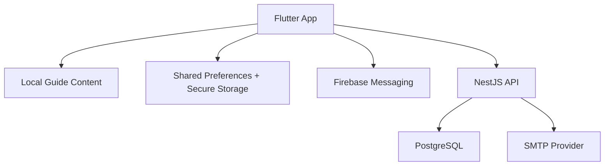
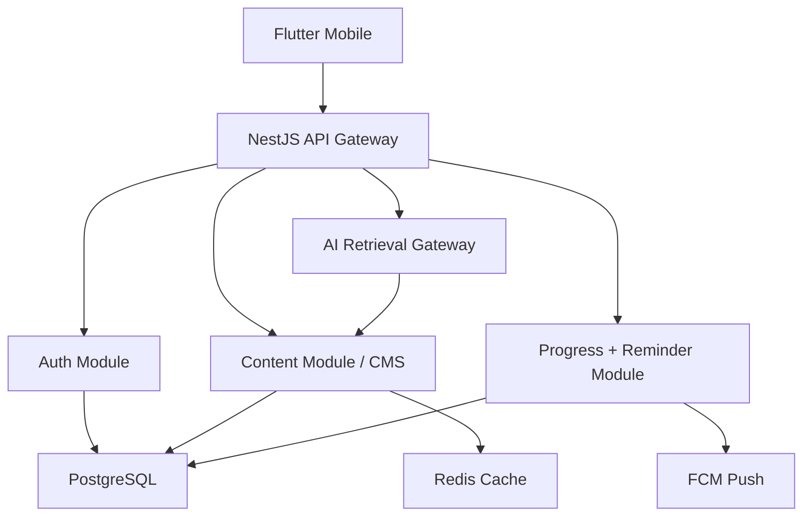

# Architecture

## Current Architecture

## Flutter Layers

- Presentation: feature widgets in `lib/features`.
- Application state: lightweight state in StatefulWidgets for current scope.
- Domain/content: immutable guide models in `lib/core/content`.
- Infrastructure: auth, secure storage, shared preferences, Firebase Messaging.

## Backend Layers

- Controllers expose HTTP endpoints.
- DTOs validate requests.
- Services implement auth and account workflows.
- Entities map sessions, users, and device tokens.
- Migrations manage database shape.

## Target Scalable Architecture

## Database Sketch

- `users`: profile, provider, verification status.
- `sessions`: refresh token hashes and expiry.
- `device_tokens`: FCM tokens per user/device.
- Future `guide_articles`: localized content, category, tags, version.
- Future `student_tasks`: checklist definitions.
- Future `user_task_progress`: per-user completion state.
- Future `reminders`: due dates, type, status, notification channel.
